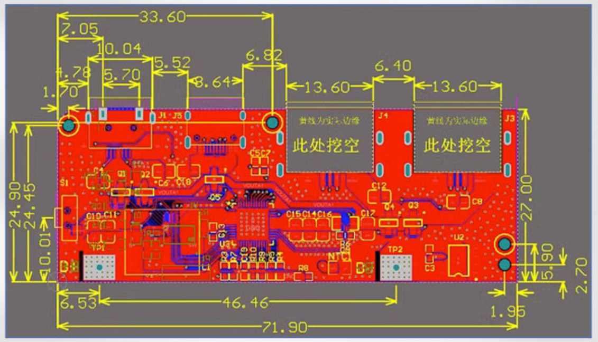
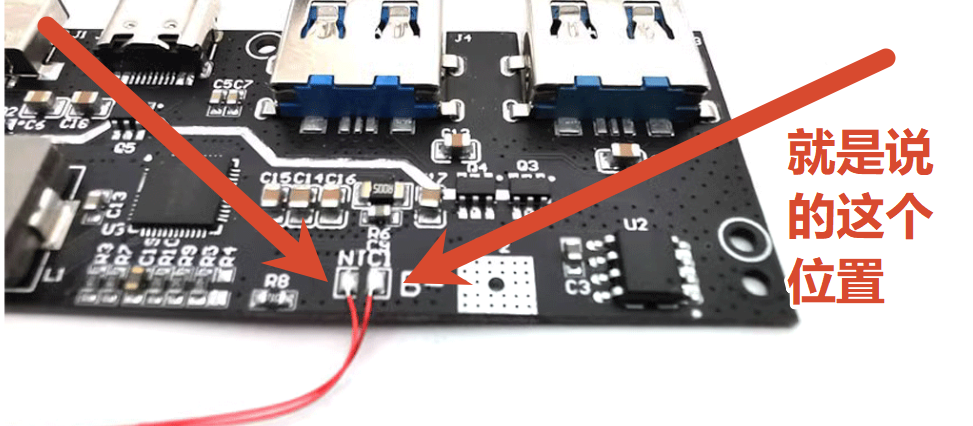
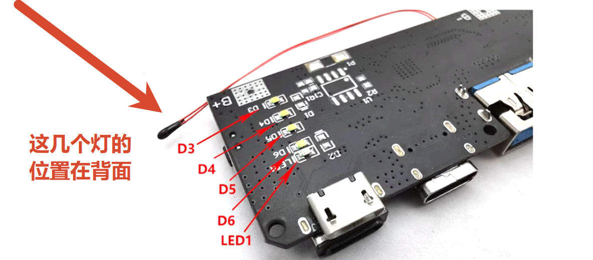
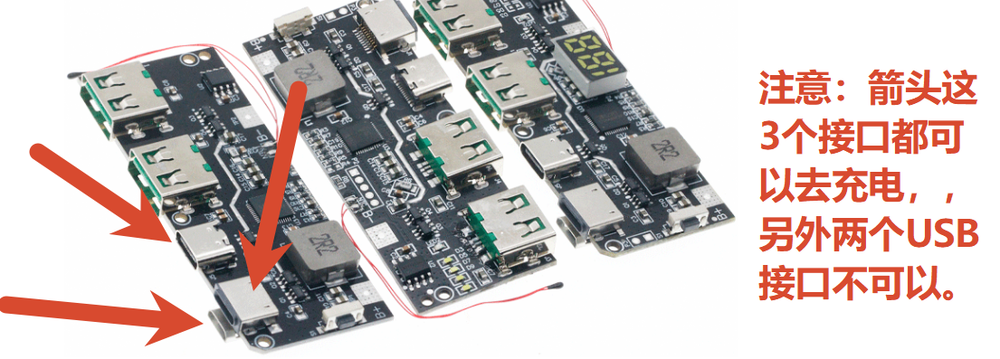
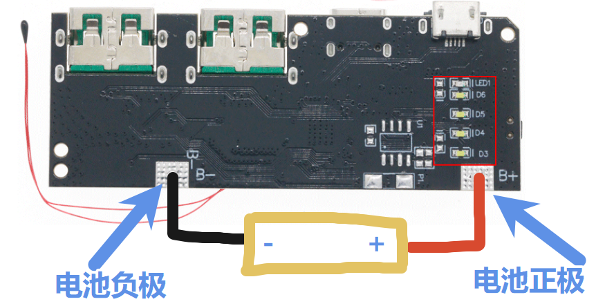

# 22.5W充电宝5口双向快充移动电源模块

请按照顺序仔细阅读教程，这里记录了产品全部重要的参数和注意事项，如需在本产品上进行焊接操作，请确保你有能力完成该操作，因为过去的时间里，我们遇到了很多次因为没有仔细阅读教程，不按照规范进行焊接导致的产品损坏。另外如有产品问题咨询请礼貌交流，我们将专业及时处理。

**使用注意事项：**

- 请勿带电操作，操作前必须切断电源。以免烧坏设备，同时防止触电。
- 人体安全电压是36V,高于36V的电压，不要去使用，不要问能不能接220V电压，不能接，220V非专业人士玩不转，不要问能不能接电动车电冰箱电风扇，都不能，在电子领域请以用电安全为第一准则，对自己安全负责。

## 一、产品特点

**开关充电：**
电流高达5A，效率高达95%、支持4.2/4.35/4.4/4.5V电池类型、持JEITA规范、支持温度环控制。
**同步声压：**
输出功率达22.5W，效率达95%、自动负载检测/轻载检测、支持无线充模式、支持小电流模式
**输出快充协议：**
支持PPS/PD3.0/PD2.0、支持QC4+/QC4/QC3.0/QC2.0、支持AFC、支持FCP、支持FCP、支持SCP、支持PE2.0/PE1.1、支持SFCP、支持VOOC。
**输入快充协议：**
支持PD3.0/PD2.0、支持AFC、支持FCP、支持SCP、支持PE1.1。Type-C接口：
内置USBType-C接口逻辑、支持Try.SRC功能。BC1.2模块：
支持BC1.2DCP模式、支持苹果/三星模式。Lightning解密:
内置 Lightning解密功能。电量计量及显示：
内置12bitADC、内置库仑计精确电量。保护机制：
输入过压保护、输出过流/短路保护、充电超时/过压保护、温度保护。

## 二、产品参数

充电流程分为如下三个过程：涓流模式、恒流模式、恒压模式。当电池电压低于3V时，充电模块处于滑流模式，充电电流为300mA；当电池电压大于3V时，充电模块进入恒流模式，此时按照设定的目标电流全速充电，功率可在21W左右；当电池电压上升到充电目标电压（比如4.2V）时，充电模块进入恒压模式，此时电流逐渐减小，而电池端电压保持不变；当充电电流减小到充电截止电流，充电结束。充满后如果电池电压降低到比目标电压低0.1V，则自动重新开始充电。（注意：电压超过4.2V属于正常，不会充坏电池，电压为4.2V时灯还在闪代表还没充满，满电不仅仅是看充电电压）

| Parameters | Symbol            | MIN  | Typical | MAX  | UNIT |
| ---------- | ----------------- | ---- | ------- | ---- | ---- |
| 输入电压   | VBUSB/VBUSC/VBUSL | 4.5  |         | 13.5 | V    |
| 电池电压   | BAT               | 2.8  |         | 4.5  | V    |
| 工作温度   |                   | -20  |         | +60  | °C   |

## 三、产品尺寸

关于主板的尺寸大家请看下图。单位mm

## 四、使用说明

NTC1焊盘是焊接电池保护温度传感器的。默认会引一根线出来装配时贴在电池表面就可以了，如果不需要直接短路2个焊盘即可；

D3,D4,D5,D6是电量LED,LED1是快充指示灯。

5个USB口均有MOS管做保护，USB口短路也不用担心。大电流走线会裸铜铺锡，降低大电流时主板发热温度。

下图中两个位置焊接电池，焊接前先仔细阅读第4点的注意事项，否则极度容易损坏，很多人没看都用不了

> [!WARNING]
>
> **主控芯片和保护芯片以及升压电感发热比较大请勿用胶水或导热硅脂等覆盖影响散热。**

## 五、注意事项

1.主板外接电池的线需要能过10A电流，最少用1平方以上的铜线，普通的线要用1.5平方。没必要太粗，但也不能太细，太细会有安全隐患。（因为电池端电流很大）
2.主板自带保护芯片，电池不能再加保护板了，如果有请拆了保护板，直接我们主板接电芯。(因为自带的一般都不能过大电流，输出功率一大就保护了）
3.使用鳄鱼夹夹主板测试使用的小伙伴们请不要充手机，不要问为什么，总之不能这样使。需要充机必须焊接必须焊接（非常多买家不听话，一有问题就来说我主板怎么坏的，主板怎么不能快充，主板怎么会断电重启等等，麻烦按照要求操作，不要自以为是。)
4.电池用4.2V的18650/聚合物/三元锂电池，大单体可以，多节18650并联也可以，不能铁锂电池、次性干电池、镍氢、铅酸电池、镍镉电池等。电池不能串联接入。第一次上电会有电量显示不准等情况请放完电再充满即可，第一次充可在4灯全亮时继续充5个时以上，不会充坏电池，需担。
